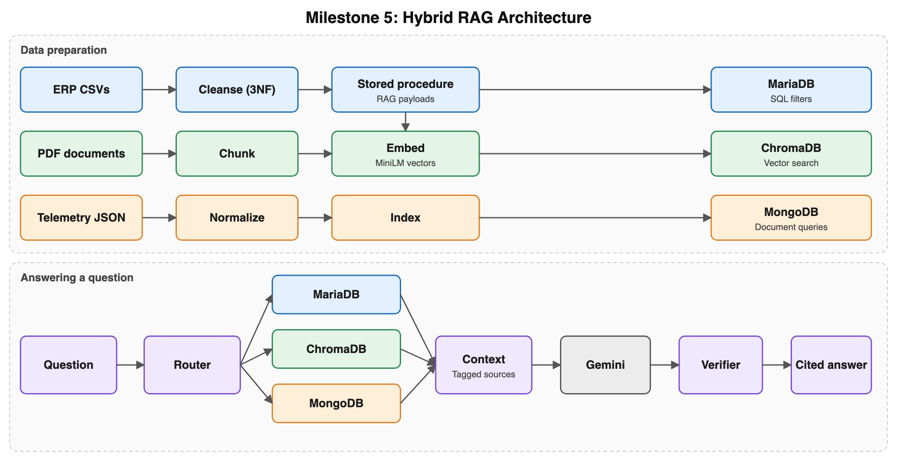
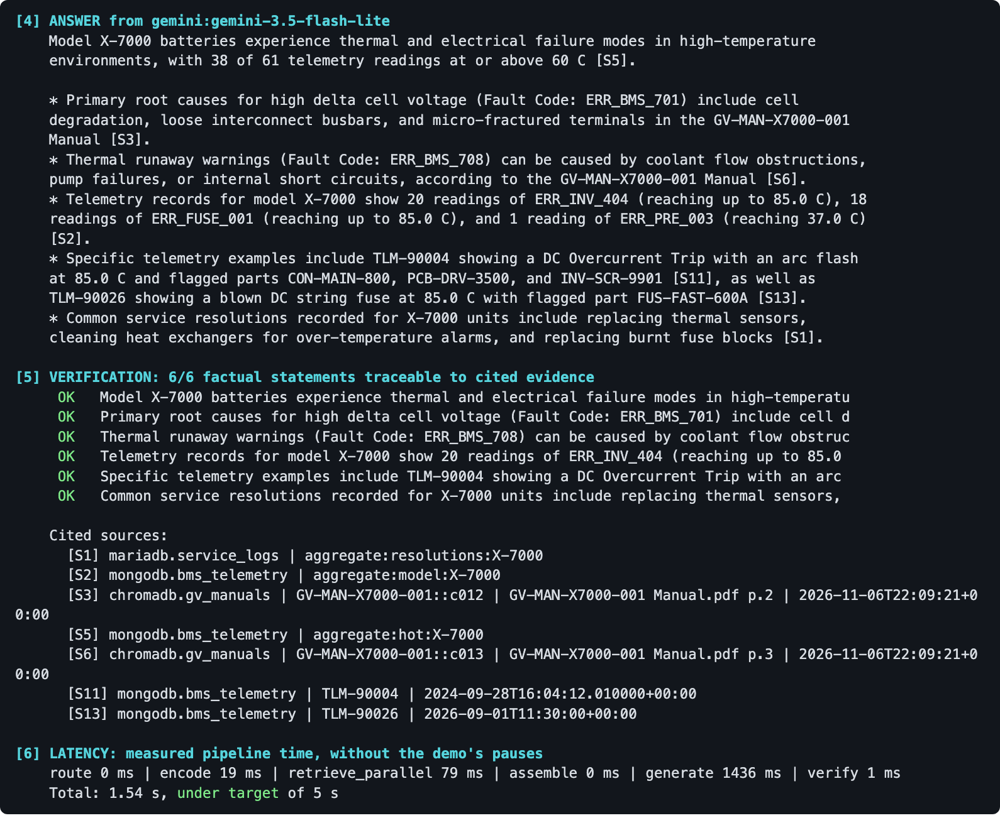
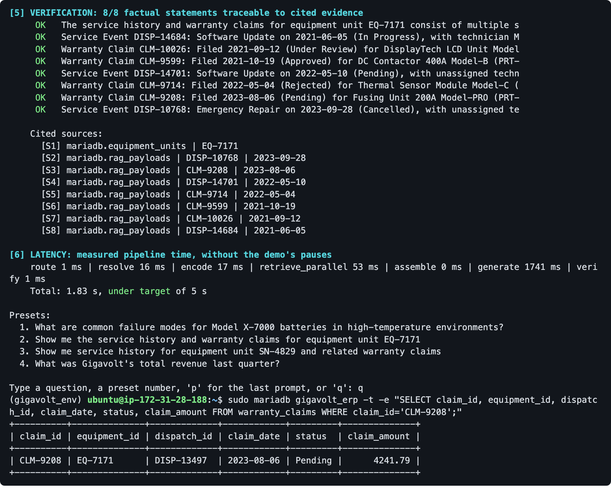

# Gigavolt Hybrid RAG

A question-answering system for a fictional battery manufacturer, Gigavolt Dynamics. Engineers ask questions in plain English, and the system answers from ERP records, technical PDFs and battery telemetry, citing the source record behind every statement.

I built it in five phases alongside my Advanced Data Management course (Fall 2026), going from messy CSV files to a working retrieval-augmented generation (RAG) system on AWS.



## Results

| Measure | Result |
|---|---|
| Median end-to-end answer time | **1.78 s** (36 benchmark runs) |
| Median retrieval time, three databases in parallel | **18 ms** |
| Answer statements traced to a source record | **190 of 199 (95.5%)** |
| Vector search (HNSW) | 0.44 ms median, recall@5 0.952 |
| Data ready for retrieval | 6,199 ERP records, 191 document chunks, 200 telemetry readings |

## How a question is answered

1. **Route:** rules read IDs, model names, fault codes and intent, then pick the databases to search. This takes under 1 ms, with no AI call.
2. **Retrieve in parallel:**
   - MariaDB returns exact records and counts.
   - ChromaDB finds document text by meaning.
   - MongoDB returns telemetry fault patterns.
3. **Build the context:** results are joined into one text string, with each snippet tagged (`[S1]`, `[S2]`) and labelled with its database and record.
4. **Generate:** Gemini answers only from that context and cites a tag for each fact.
5. **Verify:** code checks that each citation exists, and that the numbers, IDs and dates in each statement appear in the evidence it cites.



## Data

The project uses a synthetic dataset from [622.gomillion.org](https://622.gomillion.org). It isn't stored here: `infra/ec2_user_data.sh` downloads it when the server is set up.

| Source | Content | Stored in |
|---|---|---|
| ERP CSVs | Customers, equipment, dispatches, parts, warranty claims (deliberately messy) | MariaDB |
| 25 PDFs | Manuals, SOPs, datasheets, incident reports, change orders | ChromaDB |
| Telemetry JSON | Battery voltage, current, temperature, fault codes, flagged parts | MongoDB |

## Build phases

| Phase | What I built | Files |
|---|---|---|
| 1. Ingestion and cleansing | Raw CSVs loaded into staging tables, then cleaned into 3NF tables: 5 date formats standardized, HTML stripped, duplicates removed, foreign keys validated | `sql/01`–`05` |
| 2. SQL programming | A stored procedure that turns each service event and claim into a readable RAG record with provenance metadata; JSON audit triggers; masked security views | `sql/06`, `sql/07`, `sql/audit/` |
| 3. High availability | A 3-node MariaDB Galera cluster with failover testing, and a ColumnStore analytics table compared with InnoDB | `cluster/` |
| 4. Vector search | Sentence-aware chunking, MiniLM embeddings, ChromaDB with an HNSW index tuned through a parameter benchmark | `vector/` |
| 5. Hybrid RAG | Telemetry in indexed MongoDB, the hybrid retriever, the Gemini pipeline, the verifier, a live demo and a benchmark | `rag/`, `results/` |

## Design choices

- **One database per job:** SQL for exact records, vectors for meaning, a document store for nested telemetry.
- **Rule-based routing:** fast, free and explainable.
- **"No record" results:** a lookup that finds nothing returns a citable "no record exists" snippet, so a gap is never filled with a guess.
- **Gemini Flash-Lite:** keeps answers fast on a 2-vCPU instance. Local models through Ollama are also supported.
- **Data quality found in testing:** 967 of 968 dispatch-linked claims name a different unit than their dispatch, so claims are attached using the unit named on the claim itself.



## Run it

1. **Launch the server:** an Ubuntu EC2 instance (I used a `t3.medium` with 20 GiB), with `infra/ec2_user_data.sh` as user data. Set `APP_DB_PASS` in it first. It installs MariaDB, MongoDB and Python, and downloads the data.
2. **Copy the code:** put `sql/*` and `infra/build_erp_database.sh` in `/opt/gigavolt/sql/`, and `vector/src/*.py` and `rag/*` in `/opt/gigavolt/src/`.
3. **Build the data:**
   ```bash
   cd /opt/gigavolt/sql && bash build_erp_database.sh
   cd /opt/gigavolt/src && python load_telemetry.py && python build_vectors.py
   ```
4. **Add your key:** put `GEMINI_API_KEY=...` in `/opt/gigavolt/config.env`.
5. **Ask questions:** run `python demo.py`, or run `python benchmark_rag.py --repeat 3` to reproduce the benchmark.

## Repository layout

| Folder | Contents |
|---|---|
| `sql/` | Cleansing, RAG payload procedure, audit and security scripts |
| `cluster/` | Galera configuration, ColumnStore and failover scripts |
| `vector/` | Chunking, embedding and ChromaDB code, plus the HNSW benchmark notebook |
| `rag/` | Hybrid retrieval, RAG pipeline, prompt template, demo and benchmark |
| `infra/` | EC2 setup and database build scripts |
| `results/` | Latency report and test answers with provenance |

**Tech stack:** Python, SQL, MariaDB (Galera, ColumnStore), MongoDB, ChromaDB, sentence-transformers, pdfplumber, Google Gemini, AWS EC2
